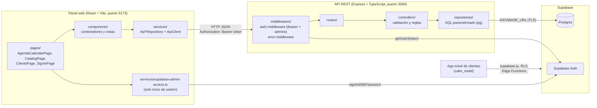
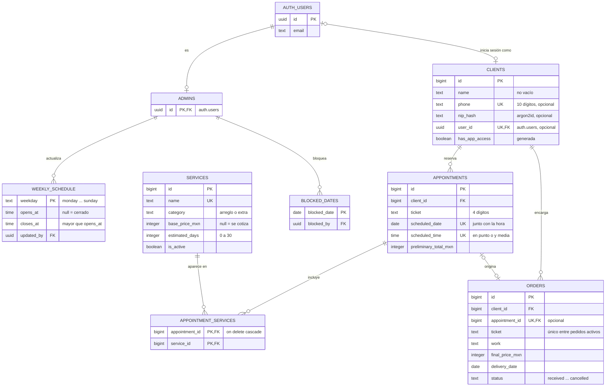
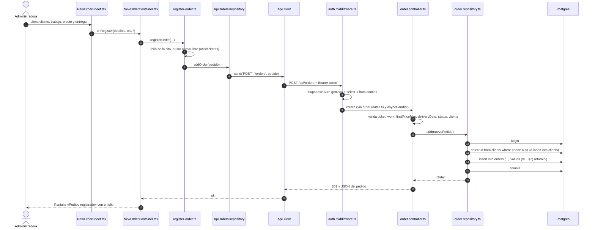

# Arquitectura del panel de CALM

El panel (React) ya no habla con la base de datos: todo lo lee y lo escribe a través de la API (Express). Supabase se usa para dos cosas: **iniciar sesión** (Supabase Auth) y **guardar los datos** (Postgres). La app móvil de clientes sigue hablando directo con Supabase y no pasa por esta API.

## Diagrama de componentes

### Qué hace cada capa

| Capa | Carpeta | Responsabilidad |
|------|---------|-----------------|
| Páginas | `src/pages/` | Una pantalla por sección: Agenda, Catálogo, Clientes, inicio de sesión. |
| Componentes | `src/components/` | Contenedores (piden datos) y vistas (solo dibujan). |
| Servicios del front | `src/services/` | `Api*Repository` implementan los puertos (`*-repository.ts`) llamando a la API con `ApiClient`, que agrega el token. |
| Rutas | `backend/src/routes/` | Asocian método y URL con un controlador, envuelto en `asyncHandler`. |
| Controladores | `backend/src/controllers/` | Validan campos, tipos e ids; aplican reglas; eligen el código HTTP. |
| Repositorios | `backend/src/repositories/` | SQL con parámetros `$1, $2…`; transacciones cuando se escriben varias filas. |
| Tipos | `backend/src/types/` | Formas JSON compartidas con el front y las interfaces de los repositorios. |
| Configuración | `backend/src/config/` | Variables de entorno, pool de Postgres, clientes de Supabase Auth. |
| Middlewares | `backend/src/middlewares/` | Guardia de administradora y traducción de errores a `{ error, code }`. |

### Seguridad en una línea

La API entra a Postgres con un rol que **no** aplica RLS, así que su guardia es la que protege los datos: cada petición necesita un token válido de Supabase Auth **y** que ese usuario esté en `admins`. Ver [api.md › Autenticación](api.md#autenticación).

## Modelo de datos

Las tablas que usa el panel, tomadas de `supabase/migrations/` (la fuente de verdad) y consolidadas en [`database/schema.sql`](../database/schema.sql).

### Reglas que guarda la base

| Regla | Restricción |
|-------|-------------|
| Una cita por espacio de 30 minutos | `unique (scheduled_date, scheduled_time)` en `appointments` |
| Un folio, un pedido activo | índice único parcial `orders_active_ticket_key` (donde `status` no es `delivered` ni `cancelled`) |
| Una cita, a lo más un pedido | `orders_appointment_id_key` |
| Un celular por clienta | `clients_phone_key` |
| Nombres de servicio únicos | `services_name_key` |
| No borrar lo que está en uso | Llaves foráneas sin cascada (salvo los servicios de una cita, que se van con ella) |

La API traduce estas violaciones a 409 (`ticket_taken`, `appointment_has_order`, `phone_taken`, `service_in_use` o `conflict`).

`sign_in_attempts` (intentos fallidos de NIP de la app móvil) también está en el esquema: la API borra los de un celular cuando le da un NIP nuevo.

## Recorrido completo: «Registrar pedido»

La administradora registra un pedido de mostrador desde la Agenda.

| Paso | Archivo | Qué pasa |
|------|---------|----------|
| 1–2 | `src/components/NewOrderSheet.tsx` → `NewOrderContainer.tsx` | El formulario valida en el navegador y entrega los detalles. |
| 3–4 | `src/services/register-order.ts` | Usa el folio de la cita, o genera uno que no esté en pedidos activos ni en citas futuras. |
| 5–6 | `src/services/api-orders-repository.ts` → `api-client.ts` | Arma `POST /orders` con `Authorization: Bearer <token de Supabase>`. |
| 7–8 | `backend/src/app.ts` → `middlewares/auth.middleware.ts` | 401 sin token válido, 403 si no es administradora. |
| 9–10 | `backend/src/routes/order.routes.ts` → `controllers/order.controller.ts` | 400 con el nombre del campo si algo no es válido. |
| 11–15 | `backend/src/repositories/order.repository.ts` | Una transacción: busca o crea a la clienta e inserta el pedido. |
| Error | `backend/src/middlewares/error.middleware.ts` | Si el folio ya está activo, Postgres viola `orders_active_ticket_key`; el repositorio lo traduce a `ticket_taken` y la API responde 409 `{ error, code }`. El `rollback` evita dejar una clienta nueva sin pedido. |
| 16–18 | De vuelta al panel | `ApiClient` convierte cualquier respuesta no 2xx en `ApiError` con el mensaje de la API. |
