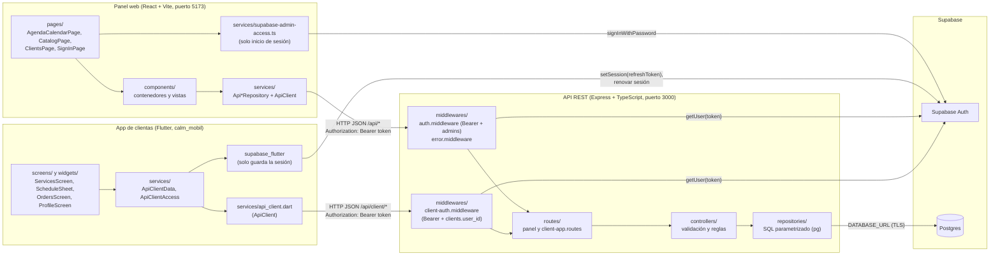
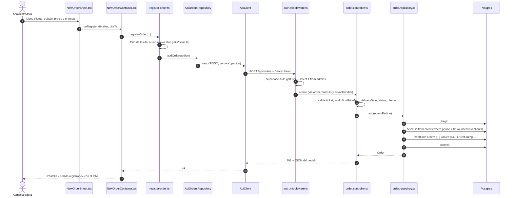

# Arquitectura de CALM

Ni el panel (React) ni la app móvil de clientas (Flutter, `calm_mobil`) hablan con la base de datos: los dos leen y escriben a través de la API (Express). El panel usa `/api/*` y la app `/api/client/*`, cada uno con su guardia. Supabase se usa para dos cosas: **las sesiones** (Supabase Auth) y **guardar los datos** (Postgres).

## Diagrama de componentes



La app sigue el mismo camino que el panel: Flutter → `/api/client/*` → `client-app.routes.ts` → `client-app.controller.ts` o `booking.controller.ts` → `client-app.repository.ts` → Postgres. `/api/client` se monta antes que la guardia de administradora; su catálogo, su calendario, el inicio de sesión y agendar con contacto no piden token, y el resto pasa por `client-auth.middleware`.

Entrar, agendar y cambiar el perfil (Edge Functions `client-sign-in`, `client-book` y `client-update-profile`), y cancelar una cita y «Voy en camino» (RPC `cancel_my_appointment` y `mark_on_my_way`) antes los llamaba la app directo en Supabase; se retiraron (`supabase/migrations/20261124120000_retire_client_rpcs.sql`) y sus reglas viven ahora en la API.

### Qué hace cada capa

| Capa | Carpeta | Responsabilidad |
|------|---------|-----------------|
| Páginas | `src/pages/` | Una pantalla por sección: Agenda, Catálogo, Clientes, inicio de sesión. |
| Componentes | `src/components/` | Contenedores (piden datos) y vistas (solo dibujan). |
| Servicios del front | `src/services/` | `Api*Repository` implementan los puertos (`*-repository.ts`) llamando a la API con `ApiClient`, que agrega el token. |
| Rutas | `backend/src/routes/` | Asocian método y URL con un controlador, envuelto en `asyncHandler`. |
| Controladores | `backend/src/controllers/` | Validan campos, tipos e ids; aplican reglas; eligen el código HTTP. |
| Repositorios | `backend/src/repositories/` | SQL con parámetros `$1, $2…`; transacciones cuando se escriben varias filas. |
| Tipos | `backend/src/types/` | Formas JSON compartidas con el front y las interfaces de los repositorios. |
| Configuración | `backend/src/config/` | Variables de entorno, pool de Postgres, clientes de Supabase Auth. |
| Middlewares | `backend/src/middlewares/` | Guardia de administradora, guardia de la clienta y traducción de errores a `{ error, code }`. |
| App de clientas | `calm_mobil/lib/` | `screens/` y `widgets/` dibujan; `services/api_client_data.dart` y `api_client_access.dart` implementan los puertos `ClientData` y `ClientAccess` llamando a la API con `ApiClient` (`services/api_client.dart`), que agrega el token de la sesión. |

### Seguridad en una línea

La API entra a Postgres con un rol que **no** aplica RLS, así que sus guardias son las que protegen los datos: una petición del panel necesita un token válido de Supabase Auth **y** que ese usuario esté en `admins`; una de la app, un token válido cuyo usuario esté ligado a una clienta (`clients.user_id`), y cada consulta filtra por esa clienta. Ver [api.md › Autenticación](api.md#autenticación) y [api.md › Guardia de la clienta](api.md#guardia-de-la-clienta).

## Modelo de datos

Las tablas que usa el panel, tomadas de `supabase/migrations/` (la fuente de verdad) y consolidadas en [`database/schema.sql`](../database/schema.sql).


### Reglas que guarda la base

| Regla | Restricción |
|-------|-------------|
| Una cita por espacio de 30 minutos | `unique (scheduled_date, scheduled_time)` en `appointments` |
| Un folio, un pedido activo | índice único parcial `orders_active_ticket_key` (donde `status` no es `delivered` ni `cancelled`) |
| Una cita, a lo más un pedido | `orders_appointment_id_key` |
| Un celular por clienta | `clients_phone_key` |
| Nombres de servicio únicos | `services_name_key` |
| No borrar lo que está en uso | Llaves foráneas sin cascada (salvo los servicios de una cita, que se van con ella) |

La API traduce estas violaciones a 409 (`ticket_taken`, `appointment_has_order`, `phone_taken`, `service_in_use` o `conflict`).

`sign_in_attempts` (intentos de NIP de la app móvil) también está en el esquema: la API cuenta cada revisión con `claim_nip_attempt` y borra los de un celular cuando el NIP es correcto o cuando el panel le da uno nuevo.

## Recorrido completo: «Registrar pedido»

La administradora registra un pedido de mostrador desde la Agenda.



| Paso | Archivo | Qué pasa |
|------|---------|----------|
| 1–2 | `src/components/NewOrderSheet.tsx` → `NewOrderContainer.tsx` | El formulario valida en el navegador y entrega los detalles. |
| 3–4 | `src/services/register-order.ts` | Usa el folio de la cita, o genera uno que no esté en pedidos activos ni en citas futuras. |
| 5–6 | `src/services/api-orders-repository.ts` → `api-client.ts` | Arma `POST /orders` con `Authorization: Bearer <token de Supabase>`. |
| 7–8 | `backend/src/app.ts` → `middlewares/auth.middleware.ts` | 401 sin token válido, 403 si no es administradora. |
| 9–10 | `backend/src/routes/order.routes.ts` → `controllers/order.controller.ts` | 400 con el nombre del campo si algo no es válido. |
| 11–15 | `backend/src/repositories/order.repository.ts` | Una transacción: busca o crea a la clienta e inserta el pedido. |
| Error | `backend/src/middlewares/error.middleware.ts` | Si el folio ya está activo, Postgres viola `orders_active_ticket_key`; el repositorio lo traduce a `ticket_taken` y la API responde 409 `{ error, code }`. El `rollback` evita dejar una clienta nueva sin pedido. |
| 16–18 | De vuelta al panel | `ApiClient` convierte cualquier respuesta no 2xx en `ApiError` con el mensaje de la API. |

## Recorrido completo en la app: «Agendar una cita»

Una clienta con sesión abierta elige sus arreglos, un día y una hora, y confirma. Las rutas de Flutter son de `calm_mobil/lib/`.

```mermaid
sequenceDiagram
    autonumber
    actor C as Clienta
    participant SS as screens/services_screen.dart
    participant SH as widgets/schedule_sheet.dart
    participant CD as services/api_client_data.dart
    participant AC as services/api_client.dart
    participant MW as client-auth.middleware.ts
    participant BO as booking.controller.ts
    participant RE as client-app.repository.ts
    participant PG as Postgres

    C->>SS: Marca arreglos (y «prenda urgente»)
    SS->>SH: showScheduleSheet(selección)
    SH->>CD: agenda()
    CD->>AC: get('/client/booking-calendar')
    AC->>RE: GET /api/client/booking-calendar (sin guardia, vía client-app.controller.ts)
    RE->>PG: select booking_calendar()
    RE-->>SH: horario, bloqueados y ocupados
    C->>SH: Elige día y hora, «Confirmar»
    SH->>CD: book(BookingRequest)
    CD->>AC: post('/client/appointments', {serviceIds, urgent, date, time})
    AC->>MW: POST /api/client/appointments + Bearer access token
    MW->>MW: Supabase Auth getUser + select ... from clients where user_id = $1
    MW->>BO: book (vía client-app.routes.ts y asyncHandler)
    BO->>BO: valida serviceIds, date, time; ventana de 62 días en hora de Cancún
    BO->>RE: activeServices() e isSlotOpen(date, time)
    RE->>PG: select ... from services where is_active / weekly_schedule, blocked_dates, appointments
    BO->>RE: book({clientId, date, time, totalMxn, serviceIds})
    RE->>PG: begin
    RE->>PG: select ticket (pedidos activos y citas futuras)
    RE->>PG: insert into appointments (...) values ($1...$5) returning id
    RE->>PG: insert into appointment_services select $1, unnest($2::bigint[])
    RE->>PG: commit
    RE-->>BO: { ticket }
    BO-->>AC: 201 { ticket, client, appointment }
    AC-->>CD: JSON
    CD-->>SH: BookingConfirmed(ticket)
    SH-->>C: Pantalla de confirmación con el folio
```

| Paso | Archivo | Qué pasa |
|------|---------|----------|
| 1–2 | `lib/screens/services_screen.dart` → `lib/widgets/schedule_sheet.dart` | La clienta marca arreglos en el catálogo (`GET /api/client/services`) y abre la hoja para agendar. |
| 3–7 | `schedule_sheet.dart` → `api_client_data.dart` (`agenda()`) | La hoja pide el calendario a la API y solo ofrece días y horas libres. |
| 8–9 | `schedule_sheet.dart` (`_confirm`) → `api_client_data.dart` (`book`) | La hoja revisa sus propias reglas y arma `BookingRequest`; sin sesión agrega el contacto (nombre, celular, NIP). |
| 10–11 | `lib/services/api_client.dart` | `ApiClient` manda el JSON con `Authorization: Bearer <access token>` de la sesión que guarda `supabase_flutter`; en el emulador la URL es `http://10.0.2.2:3000/api`. |
| 12–13 | `backend/src/routes/client-app.routes.ts` → `middlewares/client-auth.middleware.ts` | La guardia saca a la clienta del token. Sin contacto y sin sesión: 401 `signed_out`. |
| 14–16 | `backend/src/controllers/booking.controller.ts` | 400 por campo; 409 `service_unavailable` si un arreglo ya no se ofrece; el total sale del catálogo; 409 `slot_taken` fuera de la ventana o del horario. |
| 17–22 | `backend/src/repositories/client-app.repository.ts` | Una transacción: elige un folio libre e inserta la cita y todos sus servicios. |
| Error | `client-app.repository.ts` → `booking.controller.ts` | Si otra clienta tomó el espacio entre la revisión y el `insert`, Postgres viola `appointments_scheduled_date_scheduled_time_key`; el repositorio responde `slotTaken`, el `rollback` no deja nada y la API responde 409 `slot_taken`. |
| 23–27 | De vuelta a la app | `ApiClientData.book` convierte el 201 en `BookingConfirmed(ticket)` y la hoja muestra el folio; un 409 `slot_taken` marca la hora como ocupada y mueve la selección a la libre más cercana. Con contacto, instala el `refreshToken` de la respuesta como su sesión. |
